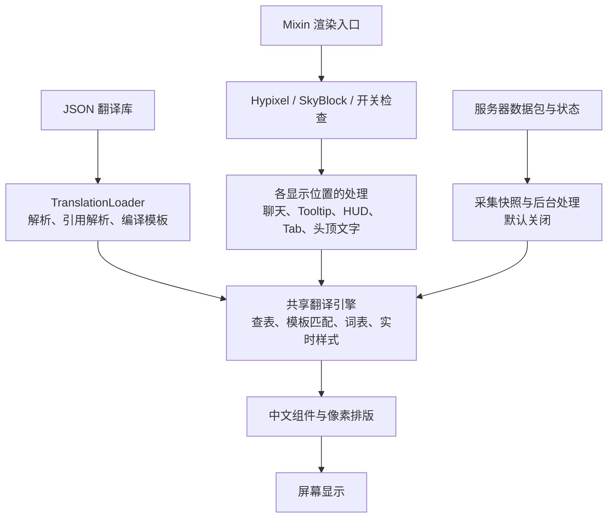

本文下半部分保留优化前的分析基线。当前实现已经完成候选索引、编译结构共享、Lore 快照复用、连续样式段、显示缓存及采集收尾改造，并在第二轮完成结构命中与语料后台加载；不降低刷新频率，也不按岛屿裁剪翻译规则。

- 动态模板只验证必含字面片段命中的候选，完整正则、占位符校验、精确优先及同分注册顺序不变。
- 一次 Lore 规划复用行快照和起点结果；继续搜索最长完整匹配，不因首次命中或句末标点提前截断。
- Tooltip 使用完整文本/样式键；无提示的原文模式直接返回。HUD、Tab、侧边栏、头顶文字复用有界显示缓存，实时颜色、字体和交互变化仍使结果失效。
- 关闭采集和断线由后台排空写盘；退出时队列入队与等待共用 30 秒期限。辅助别名索引各限制为 16,384 项，重复观测携带可恢复证据，逐出后可重新分类。
- 309 条源记录改为共享引用，复用 175 份相同定义；解引用后的运行时字段保持一致。测试与样本统一在 `tests/`。
- 原版每帧重建头顶文字、侧边栏、Tab 行与 Tooltip（头顶文字还带新的悬浮事件）。纯字面文本按逐节点文本、样式和子节点数记录结构，命中时不再展平、深拷贝和深度哈希；结构相同必然展平相同，原地修改会落空并回到完整键。
- 样式哈希不再调用每次装箱十个字段、深度哈希悬浮事件的 `Style.hashCode()`；一次展平内继承同一悬浮事件的各段只复制一次。
- 语料在后台线程解析编译（离线冷启动约 1.5 s），随后预读原本首次使用时才加载的物品名目录与区域表；加载完成前 SkyBlock 判定保持关闭，渲染和采集不会用空索引判断文本。
- 图标字形改为数组查表，`Glyphs.restore` 单遍收集本行字形；终端标题、物品名判定、时长、Tab 品质标记等热路径正则改为预编译。强制档 Tooltip 的改动比较按缓存结果复用。

`./gradlew checkPerformance` 对真实语料及变体执行 530,574 项断言，将候选查询的胜出记录和捕获范围与旧逐条扫描对照，逐条对照显示缓存经结构命中与未缓存翻译的结果，并检查范围样式、可变悬浮文本、哈希碰撞、原地修改后的结构失效、字形折叠与旧实现一致、缓存失效与采集逐出恢复。现有 Lore、聊天交互、采集、诊断、配置与 Mixin 检查继续参与每个目标的 `check`。

同机 JDK 25 / Minecraft 26.3 的 `benchmarkPerformance` 对照如下。数值为离线平均值，受 JIT 和同时运行的进程影响；未测实机 P95/P99 帧耗时、资源包渲染或辅助 Mod 组合，不能换算成 FPS。

| 场景 | 优化前耗时 | 优化后耗时 | 优化前分配 | 优化后分配 |
|---|---:|---:|---:|---:|
| 动态物品属性冷查询 | 317 μs | 6.4 μs | 809 KiB | 2.7 KiB |
| 未收录物品冷查询 | 354 μs | 5.2 μs | 834 KiB | 1.9 KiB |
| 未收录 Lore 冷查询 | 240 μs | 3.8 μs | 713 KiB | 1.4 KiB |
| 20 行 Lore 热缓存重新规划 | 320 μs | 187 μs | 885 KiB | 149 KiB |
| 20 行 Lore 改变一个属性数值 | 3.35 ms | 0.40 ms | 9,436 KiB | 234 KiB |
| 21 行原文 Tooltip，无提示 | 30.6 μs | 0.5 μs | 83 KiB | 0.04 KiB |

第二轮改造前后在同一次会话中测得：

| 场景 | 改造前耗时 | 改造后耗时 | 改造前分配 | 改造后分配 |
|---|---:|---:|---:|---:|
| 20 行 Lore 热缓存重新规划 | 166 μs | 115 μs | 149 KiB | 138 KiB |
| 20 行 Lore 改变一个属性数值 | 212 μs | 193 μs | 164 KiB | 153 KiB |
| 13 行侧边栏，每帧重建 | 5.3 μs | 1.5 μs | 13.1 KiB | 1.7 KiB |
| 60 个头顶文字，每帧重建并带悬浮事件 | 64 μs | 13 μs | 191 KiB | 16 KiB |

头顶文字的改造后数值里约 2–3 μs、16 KiB 是基准自身每帧构建组件的开销。

以下为优化前的分析与原始测量。

---

**优化前最有证据的瓶颈是：动态文本需要扫描大量翻译模板，而 Lore 的跨行搜索会进一步放大扫描次数和临时对象分配。** 其次是缓存命中前的构键成本，以及头顶文字、Tab、HUD 等位置重复处理相同文本。这些问题都有保持现有翻译效果的优化空间。

我已梳理主要调用链，用当前语料和真实引擎做了离线测量，并让两个 GPT 6 Luna 子 Agent 分别复核匹配引擎、渲染与采集路径。下面的耗时来自本机 JDK 25、Minecraft 26.3 目标的离线程序，**不包含实际客户端的字体绘制和其他 Mod 开销，不能直接换算成 FPS 提升**。

从架构看，现有设计有不少值得保留的基础：

项目采用 Fabric、JDK 25，通过共享源码加少量版本适配支持 26.1、26.2、26.3。翻译发生在显示路径，原始 `ItemStack`、聊天历史和服务器状态保持英文，这对 SkyHanni、SkyBlocker 等 Mod 的兼容性很重要。

引擎已经具备精确查表、正则预编译、成功／失败匹配缓存、Tooltip 结果缓存、聊天折行缓存和后台采集。当前需要重点改进的是这些机制面对大语料时的成本。

当前实际规模如下：

| 渲染面 | 精确文本索引 | 动态模板 |
|---|---:|---:|
| 聊天／NPC 对话 | 11,481 | 1,405 |
| 物品名／旧式逐行 Lore | 10,876 | **4,664** |
| 完整 Lore 句子 | 4,771 | **3,256** |
| 其他七个渲染面合计 | 2,145 | 946 |

源语料共有 **2,337 个 JSON 文件、43,407 条记录**，另有 3,622 条词表数据。这里还有一个架构细节：**运行时按渲染面隔离，并没有按玩家所在岛屿隔离。** 这意味着查看一个物品时，物品模板包含各玩法的规则；但直接按岛屿裁剪词库也会漏掉随玩家携带的物品和跨玩法菜单。

按收益与保持体验的可行性，我建议这样排序。

1. **最高优先级：为动态模板建立候选索引。**

   [TranslationIndex.java](C:/Users/user/Desktop/MinecraftMods/SkyZH/src/main/java/io/github/bingkkni/skyzh/text/TranslationIndex.java:136) 当前的查找顺序是：查缓存 → 查精确文本 → 遍历该渲染面的模板。

   缓存键是完整原文，因此 `Damage: +1234` 和 `Damage: +1235` 属于两个键。动态数值、倒计时和不断变化的商品信息，都可能重新走模板扫描；未收录文本则需要尝试全部模板才能确认没有译文。

   实测 `Damage: +1234` 首次查找执行了 **4,515 次模板匹配**。这能直接解释为什么增加翻译后，部分操作会越来越贵。

   建议在加载时，按模板必需的前缀、字面词或其他可靠特征建立索引，查询时只检查可能匹配的候选。没有可靠特征的模板保留兜底集合，最终仍执行现有完整匹配与占位符校验。

   我做了一个临时的保守首字符索引原型：

   | 冷查场景 | 当前引擎平均耗时 | 临时候选索引 |
   |---|---:|---:|
   | 动态物品属性 | 约 317 μs | 约 77 μs |
   | 未收录物品文本 | 约 344 μs | 约 136 μs |
   | 未收录 Lore 文本 | 约 222 μs | 约 19 μs |

   对 **80,628 个原文模板及合成变体**进行比较，胜出的记录对象没有差异。这支持该方向值得实施。不过原型尚未接入生产缓存，两组测量也不是严格的完整路径 A/B，不能把这个比例当作最终收益承诺。

   必须保留精确匹配优先、`specificity` 排名、平手时原有顺序、单复数兼容、`exclude`、占位符类型和示例约束。仅把模板按优先级排序，收益有限：上述属性样例仍需尝试四千多条，未知文本仍需全部尝试。

2. **同样值得优先处理：减少 Lore 不可能成功的跨行搜索。**

   [LoreMatcher.java](C:/Users/user/Desktop/MinecraftMods/SkyZH/src/main/java/io/github/bingkkni/skyzh/text/LoreMatcher.java:46) 会从某个起点尝试一行、两行、三行……最多 12 行；每次继续拼接，都重新展平文本、生成候选并查询索引。[LoreTranslation.java](C:/Users/user/Desktop/MinecraftMods/SkyZH/src/main/java/io/github/bingkkni/skyzh/text/LoreTranslation.java:26) 又会从后续多个起点调用它。

   在一个 **20 行合成物品说明**中，冷缓存规划产生了约 **18.3 万次模板匹配尝试**：

   | 状态 | 平均耗时 | 单次累计临时分配 |
   |---|---:|---:|
   | 匹配缓存已热，重新生成计划 | 约 0.12 ms | 约 246 KiB |
   | 只改变一个属性数值 | 约 0.83 ms | 约 2.3 MiB |
   | 冷缓存 | **约 13.5 ms** | **约 37.5 MiB** |

   这里的分配量是操作过程中分配过的对象总量，不是永久占用。这类分配也会增加垃圾回收压力。

   这项结果尤其值得在首次悬停新物品、快速切换物品时验证。普通翻译模式下，并不会因为打开一个箱子就同步翻译里面所有物品；重点是实际进入 Tooltip 路径的内容。

   建议复用已经展平的行和增量拼接结果，并利用候选索引判断“是否仍可能形成更长匹配”。**只有能证明继续拼接不可能成功时才提前结束**，仍须保留最长完整匹配、空行边界、12 行／2,048 字符限制，以及旧式 `continuation` 回退。

   直接在首次命中后返回，会改变现有跨行翻译语义，不适合采用。

3. **第二优先级：降低 Tooltip 缓存命中本身的成本。**

   [TooltipTranslator.java](C:/Users/user/Desktop/MinecraftMods/SkyZH/src/main/java/io/github/bingkkni/skyzh/text/TooltipTranslator.java:218) 已缓存最终结果，但每次查询之前仍会遍历所有行，构造 `StyledText`，逐字符计算 `Style.hashCode()`，再把这些哈希值拼成一个大字符串作为键。

   所以鼠标停在同一物品上，仍会每帧执行这段工作。离线测量中，21 行 Tooltip 在原文模式下热命中缓存，平均约 **29 μs、102 KiB 临时分配／次**。原文模式用于隔离构键成本，没有测量字体排版。

   单次耗时明显小于冷模板扫描，但它是持续分配来源。建议改为紧凑的不可变文本／样式快照，按连续样式段存储和比较，避免每个字符都输出十进制哈希字符串。

   缓存仍需比较完整样式和行边界，并正确处理原文模式、提示键、终端名称保护、字体与配置变化。仅用文本或仅用哈希值判断相同，都不足以保证显示正确。

4. **第二优先级：让一次渲染共用文本快照和匹配结果。**

   [NameTag.java](C:/Users/user/Desktop/MinecraftMods/SkyZH/src/main/java/io/github/bingkkni/skyzh/hook/NameTag.java:154) 的一次处理可能先检查计时器、再检查生物血条、再检查翻译资格，然后 `locate`，最后再次进入翻译。多个步骤会重复展平同一个组件或重复匹配。

   HUD、侧边栏、Tab 也会反复处理文本；现有匹配缓存只省掉寻找记录，后面的样式解析、中文组件构造和部分测宽仍会执行。

   建议先让这些步骤共用一次 `StyledText` 和一次匹配结果，再对内容与完整样式均未改变的文本复用显示结果。这样无需降低刷新频率。

   **侧边栏跑马灯必须继续响应实时颜色变化。** 文字内容不变并不代表显示不变，不能用纯文本缓存把动画固定住。同理，不能只凭可变 `Component` 对象的身份判断它没有变化。

5. **可以顺带完成的较小优化：减少重复编译、匹配和临时组件。**

   这些收益应排在前两项之后，但实现范围相对明确：

   | 位置 | 当前成本 | 可采用的优化 |
   |---|---|---|
   | [Capture.java](C:/Users/user/Desktop/MinecraftMods/SkyZH/src/main/java/io/github/bingkkni/skyzh/text/Capture.java:314) | 部分校验通过 `String.matches` 重复编译固定正则 | 将固定规则预编译 |
   | `TranslationIndex` → `Translator`／`LoreMatcher` | 冷查已匹配成功，调用方又匹配一次 | 在同次查询中传递匹配结果；不跨线程共享可变 `Matcher` |
   | [StyledText.java](C:/Users/user/Desktop/MinecraftMods/SkyZH/src/main/java/io/github/bingkkni/skyzh/text/StyledText.java:180) | 子范围复制字符串和样式数组 | 评估不可变范围视图，减少重复复制 |
   | [TextLayout.java](C:/Users/user/Desktop/MinecraftMods/SkyZH/src/main/java/io/github/bingkkni/skyzh/text/TextLayout.java:77) | 折行时为单个字符构造临时组件再测宽 | 使用保持字体、样式语义的字符测量路径 |

   字体测量优化仍要保留中文标点避头尾、缩进、粗体和 Unicode 补充字符等现有规则。

6. **加载与驻留内存优化：共享重复记录的编译结构。**

   我按源分段、译文、占位符编号／类型／示例、排除项和布局等运行时字段检查，物品模板中有 **590 个额外的相同字段实例**，完整 Lore 中有 **89 个**。例如同一 `Mining Speed: %s` 规则出现了几十次。

   `ref` 已避免重复维护翻译文本，但加载器仍会为引用位置分别编译记录。可以共享不可变的匹配／编译结构，同时保留每条记录的 `id`、来源和诊断信息。

   这主要改善启动、内存和重复编译成本。不能仅凭英文模板相同就合并记录，因为分段、类型约束和布局可能不同；聊天合并还依赖记录身份。

   打包时目前已经删除大量翻译说明字段，JSON 精简也已经存在。继续压缩文件体积对逐帧卡顿的帮助，预计低于前面的匹配优化。

采集模式还有一组独立问题，需要单独安排。**采集默认关闭，下面几项不能用来解释所有普通玩家的卡顿。**

| 问题 | 已确认的行为 | 建议 |
|---|---|---|
| 主线程快照成本 | Lore 分析已在后台，但容器包仍在主线程逐物品展平文本、保存快照并计算签名 | 复用未变化的不可变快照、降低签名成本；继续保证后台不会读取后来变化的物品 |
| 采集与渲染共用缓存 | 两者使用同一个每渲染面 2,048 项的匹配缓存 | 测量淘汰情况，再考虑分离缓存或避免批量采集驱逐显示热点 |
| 长会话辅助索引增长 | 2,000 次不同数值观测合并为 **1 条记录**，但 `BY_KEY` 和 `SHARED` 都有 **2,000 项** | 给辅助索引设置协调的容量／生命周期策略，确保逐出后不会漏掉新证据 |
| 结束采集可能阻塞客户端 | `finishPending()` 会等待锁、执行无超时的 `QUEUE.put`，之后才开始 30 秒等待；超时后还可能同步写盘 | 普通关闭／断线路径异步完成，退出程序另设统一截止时间 |

后两项可以在 [CaptureStore.java](C:/Users/user/Desktop/MinecraftMods/SkyZH/src/main/java/io/github/bingkkni/skyzh/capture/CaptureStore.java:330) 中定位。文件数和记录数上限约束不到全部辅助键，所以长时间开启采集后，需要关注这部分内存增长。

实施顺序建议是：**先做动态模板候选索引，再做 Lore 增量处理与可靠剪枝，随后优化 Tooltip 构键和重复渲染，采集问题作为独立一批处理。** 第一项已有较强的离线可行性证据；第二项潜在收益大，但对跨行语义的验证要求更高。

要证明“不影响实际体验”，验收应同时包含：

- 用真实语料和采集样本，对比新旧引擎的胜出记录、捕获值、消费行数和完整样式；运行现有翻译、Lore、聊天交互及诊断检查。
- 实机检查侧边栏颜色动画、动态倒计时、中文折行、字体重载、原文切换，以及辅助 Mod 组合。
- 在首次悬停、反复悬停、快速切换物品、打开 Tab、大量头顶文字和长时间采集场景下，比较 **P95／P99 帧耗时、每秒分配量和 GC 暂停**。
- 性能对照使用总开关关闭或移除 Mod 的基线。X 原文模式仍可能构造 Tooltip 缓存键，不能视为完全无 Mod 开销。

本轮完成的是架构与性能分析，没有修改生产代码、翻译或版本号；临时基准源码、脚本、编译结果和日志已清理，Git 工作区保持干净。
